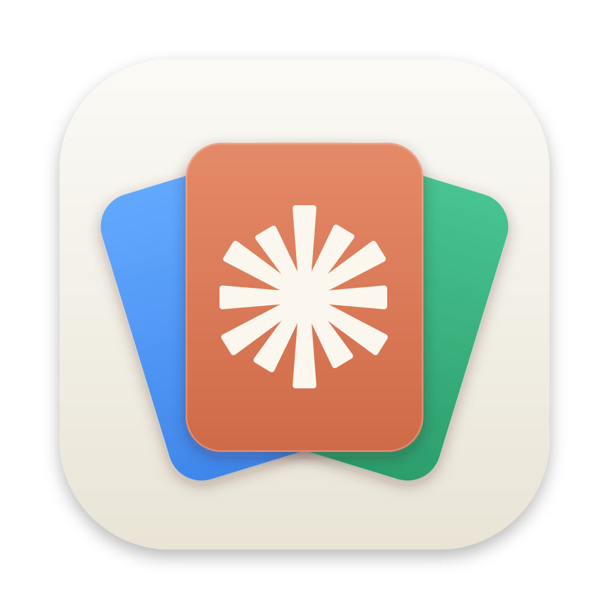

  
  <h1>claude-profile</h1>
  
Separate Claude Code profiles on one machine – each with its own settings, history and login.

  

    <a class="primary" href="getting-started.html">Get started</a>
    <a href="tutorial.html">Tutorial</a>
    <a href="reference/commands.html">Commands</a>
  

`claude-profile` splits Claude Code on one machine into several **profiles** – for example one for your personal Claude subscription and one for Vertex AI through your company. Each profile has its own config directory with its own settings, its own history and its own login.

Claude Code itself has no notion of profiles. `claude-profile` solves this with three building blocks:

### One directory per profile

`~/.claude-<name>`, passed at start as `CLAUDE_CONFIG_DIR`.

### No start without a profile

The `claude` command becomes a shell function that always resolves a profile first. There is no silent default profile.

### A symlink for everything else

`~/.claude` and `~/.claude.json` point to a profile of your choice, so programs that have the default path hard-wired end up in exactly that profile.

## Who is this for?

For you, if you use Claude Code in two contexts whose data must not mix and you don't want to run a virtual machine for that.

## Where to start?

| You want to … | Read … |
|---|---|
| install the tool | [Installation](installation.md) |
| have a first profile in five minutes | [Getting started](getting-started.md) |
| see the whole flow with two profiles | [Tutorial](tutorial.md) |
| look up a command | [Commands](reference/commands.md) |
| understand what is isolated and what is not | [How it works](how-it-works.md) |

## Status

Version 0.1 for macOS (main target) and Linux, bash and zsh. The commands for Claude Code in the terminal are tested. The commands for **Claude Desktop** (macOS only) have been tried with the real app – details in [Claude Desktop per profile](guides/desktop.md).
